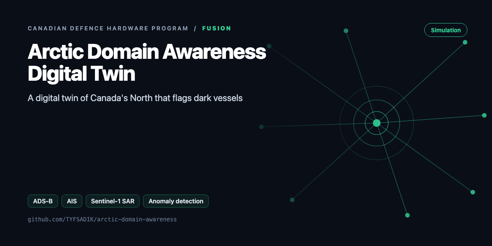
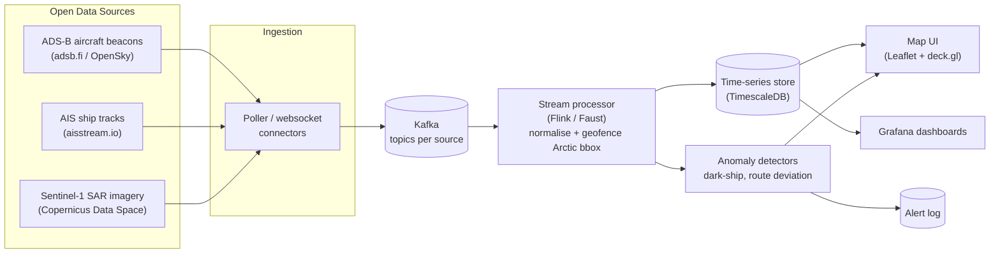

<div align="center">



# Arctic Domain Awareness Digital Twin

**Streaming pipeline fusing ADS-B aircraft data, AIS ship tracking, and Sentinel-1 radar imagery over Canada's North, with anomaly detection for dark vessels.**

[](https://github.com/TYFSADIK/arctic-domain-awareness/actions/workflows/tests.yml)   [](LICENSE) [](https://github.com/TYFSADIK/defence-hardware-program)

[Build guide](docs/project-page.md) · [How it works](#how-it-works) · [Quick start](#quick-start) · [Program hub](https://github.com/TYFSADIK/defence-hardware-program)

</div>

## Overview

Canada's Arctic is vast, remote, and increasingly busy. This project builds a **digital twin of the air and maritime picture over the North** using nothing but open data: ADS-B aircraft beacons, AIS ship transponders, and Sentinel-1 synthetic-aperture radar imagery. All three streams flow into one pipeline that maintains a live picture of who is where, and raises flags when something looks wrong.

The two flagship anomaly detectors are **dark-vessel detection** (a ship that stops transmitting AIS but keeps appearing in radar imagery) and **route deviation** (an aircraft leaving its filed or historical corridor). Both are classic sovereignty and safety concerns in the Arctic, and both can be prototyped entirely with public data.

This is directly relevant to **NORAD modernization** and Canada's Arctic sovereignty agenda: the hard part is not sensors, it is fusing heterogeneous feeds into one trustworthy, queryable picture. That is a data-engineering and DevOps problem, and that is what this project practices.

## How it works



*Sources, streaming backbone, storage, detection, and presentation layers.*

## Quick start

```bash
python demo.py
python -m unittest -v
```

Real output from the demo, run on simulated data:

```text
{'rule': 'ais_gap', 'mmsi': '316000002', 'start': 1750000000, 'end': 1750032400, 'hours': 9.0, 'lat': 69.1, 'lon': -100.0}
{'rule': 'dark_vessel', 'det': 'S1-002', 't': 1750003600, 'lat': 70.2, 'lon': -98.5}
log intact: True
score: {'tp': 1, 'fp': 0, 'fn': 0, 'precision': 1.0, 'recall': 1.0}
```

## What's in this repo

| File | Purpose |
|---|---|
| `arctic/eventlog.py` | Append-only, hash-chained JSONL event log with replay and `verify()` |
| `arctic/models.py` | AIS and SAR record types, haversine distance, dead-reckoning |
| `arctic/ingest.py` | Parsers for AIS CSV, SAR detection CSV, and dump1090/readsb `aircraft.json` |
| `arctic/anomaly.py` | AIS gap, speed-jump (spoofing), and dark-vessel rules, plus precision/recall scoring against labels |

## What you need

| Category | Item | Notes |
|----|----|----|
| Hardware | A server or capable laptop | Runs Kafka, TimescaleDB, and the UI; my homelab Kubernetes cluster is the target, a single machine works for the prototype |
| Software | Kafka (KRaft), Python, Faust or Flink, TimescaleDB, MinIO, Leaflet/deck.gl, Grafana, Terraform + Helm | All open source |
| Skills | Python, SQL, streaming basics, basic GIS concepts (bounding boxes, projections) | Familiarity with Kafka offsets and replay makes detector tuning much easier |
| Accounts | Copernicus Data Space (free) for Sentinel-1; AIS websocket access (aisstream.io offers free access); ADS-B API (adsb.fi offers a free public API, OpenSky is an alternative) | Register before building the connectors; rate limits shape the poller design |

## Status

- **Done**: architecture design, source evaluation, common track model, homelab Kubernetes target.
- **In progress**: AIS + ADS-B ingestion connectors, geofenced normaliser.
- **Next**: gap detection, map UI, then Sentinel-1 correlation and confidence scoring.

## Roadmap

- [ ] Pull Sentinel-1 GRD scenes for a fixed AOI (e.g. Lancaster Sound) from ASF and run ship detection
- [ ] Feed AIS from your own RTL-SDR receiver (see the water-acoustic repo) or an AIS Hub export
- [ ] Build a labelled history set (known dark events) and track precision and recall per rule over time
- [ ] Stream with NATS or Kafka and keep the JSONL log as the replayable source of truth
- [ ] Map view: anomalies as GeoJSON, opened in QGIS or Leaflet

## Related builds

- [Multi-Domain Common Operating Picture](https://github.com/TYFSADIK/multi-domain-common-operating-picture), the fusion layer that would consume these Arctic tracks alongside the hardware sensor builds.
- [Counter-Drone Sensor Fusion Simulator](https://github.com/TYFSADIK/counter-drone-sensor-fusion), the same Kalman-filter fusion approach applied to synthetic radar, RF, acoustic, and camera tracks.
- [Canadian Defence Hardware Program](https://github.com/TYFSADIK/defence-hardware-program), the program hub with all 11 builds, phased BOMs, and build guides.

## Learn more

The full build guide, with step-by-step instructions, wiring, troubleshooting and lessons learned, is in [docs/project-page.md](docs/project-page.md). It is also published at [tyfsadik.org](https://tyfsadik.org/work/defence/arctic-domain-awareness.html).

## License

[MIT](LICENSE). Built by [Taki Sadik](https://tyfsadik.org) as part of the self-funded [Canadian Defence Hardware Program](https://github.com/TYFSADIK/defence-hardware-program).
